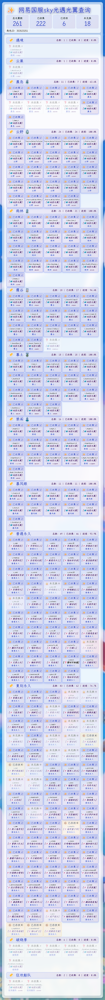
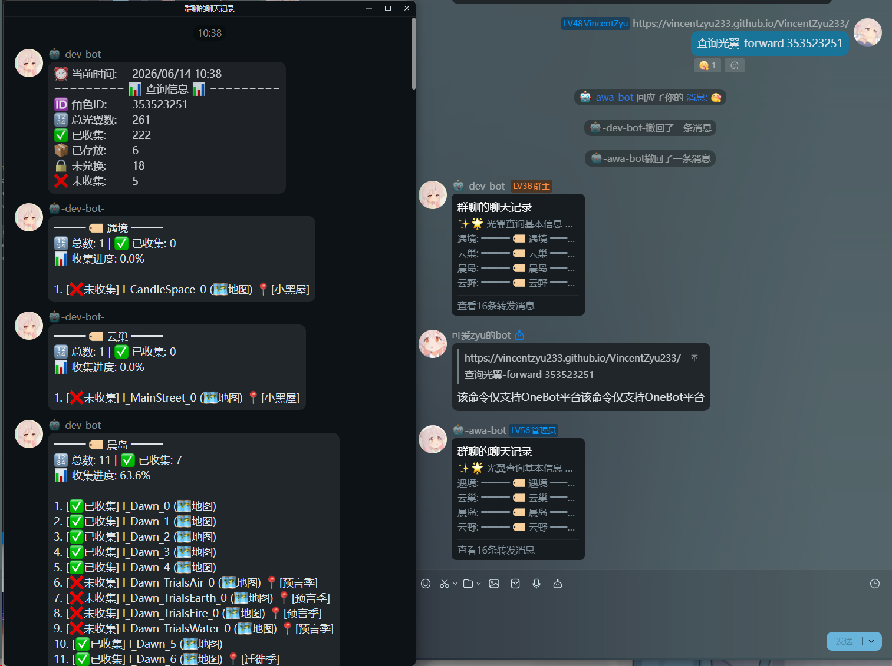
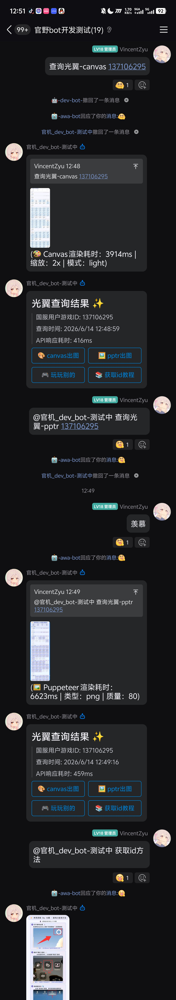

# 🤖 Koishi 插件介绍

`koishi-plugin-wydashen-guangyi-query` 是一个 Koishi 聊天机器人插件，通过网易大神接口查询《光·遇》国服玩家的光翼收集情况，并支持多种渲染与转发方式。

[](https://www.npmjs.com/package/koishi-plugin-wydashen-guangyi-query)
[](https://www.npmjs.com/package/koishi-plugin-wydashen-guangyi-query)

## 功能特性

- 🪽 光翼查询：输入角色短 ID，返回收集概览
- 🖼️ 双引擎出图：Puppeteer 高清长图 / Canvas 快速渲染
- 📄 纯文本结果与 OneBot 合并转发
- 🎒 藏宝阁衣柜：配合本站 API（UUID 查询）
- 📚 内置「获取 ID」教程图

## 安装

在 Koishi 控制台「插件市场」或「依赖管理」搜索安装，或在 monorepo 中（使用 npm 也可以）：

```bash
yarn add koishi-plugin-wydashen-guangyi-query
```

## 指令一览

| 指令 | 别名 | 说明 |
| :--- | :--- | :--- |
| `查询光翼-pptr <角色ID>` | 查询光翼 / aqg / aqgp | Puppeteer 渲染光翼长图（默认） |
| `查询光翼-canvas <角色ID>` | aqgc | Canvas 快速出图 |
| `查询光翼-text <角色ID>` | aqgt | 纯文本结果 |
| `查询光翼-forward <角色ID>` | aqgf | OneBot 合并转发 |
| `获取光遇国服玩家id方法` | atw | 发送获取 ID 教程图 |
| `刷新光翼` | awa_refresh_guangyi | 刷新光翼映射数据 |

## 简单使用

```
查询光翼 380594330
```

机器人会返回该角色的光翼收集长图。

## 效果预览

> 以下示例图直接引用插件仓库 main 分支的 GitHub raw 资源。

**🎴 Puppeteer 渲染长图**



**🖥️ Canvas 出图**


**📄 OneBot 合并转发**



**🔘 QQ Markdown 按钮**



